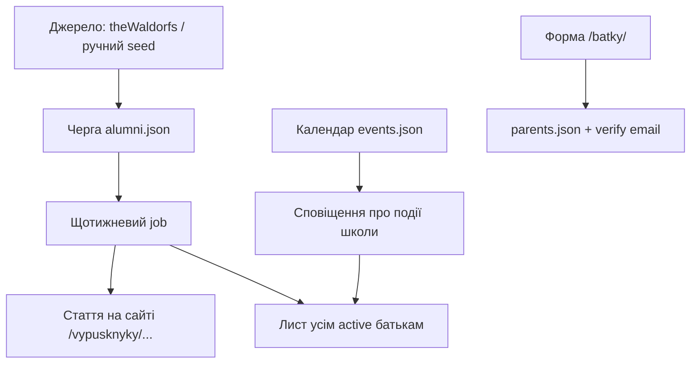

# Батьки + випускники: автоматичний конвеєр

Фіча для сайту «Ступені»: реєстрація батьків, щотижнева стаття про відомого (або менш відомого) випускника вальдорфської школи, розсилка підписникам і сповіщення про події школи.

Статус: **каркас (MVP scaffold)** — працює локально без зовнішньої пошти; імпорт/публікація/розсилка готові до підключення SMTP/Resend і cron.

---

## Що робить система (автоматично)



1. Батько реєструється на `/batky/` (email, ім’я, клас дитини, згоди).
2. Підтверджує email за посиланням → статус `active`.
3. Раз на тиждень job:
   - бере наступного випускника зі статусом `queued`;
   - генерує українську статтю з шаблону;
   - публікує HTML у `/vypusknyky/<slug>/`;
   - додає запис у `alumni-articles.json` і (опційно) у стрічку новин;
   - надсилає лист усім `active` батькам з коротким текстом і посиланням на статтю.
4. Окремо: сповіщення про найближчі події з календаря (той самий mailer).

---

## Файли даних (`data/`)

| Файл | Призначення |
|------|-------------|
| `parents.json` | Підписники-батьки |
| `alumni.json` | Черга + опубліковані випускники |
| `alumni-articles.json` | Опубліковані статті (метадані) |
| `mail-log.json` | Журнал листів (і stub без SMTP) |

Каталог статей на диску: `vypusknyky/<slug>/index.html`.

---

## API

### Публічні

| Метод | Шлях | Опис |
|-------|------|------|
| `POST` | `/api/public/parents/register` | Реєстрація |
| `GET` | `/api/public/parents/verify?token=` | Підтвердження email |
| `GET` | `/api/public/parents/unsubscribe?token=` | Відписка |
| `GET` | `/api/public/alumni` | Опубліковані випускники |
| `GET` | `/api/public/alumni/:slug` | Одна стаття (JSON) |

### Адмін (JWT, право `settings` або `news`)

| Метод | Шлях | Опис |
|-------|------|------|
| `GET` | `/api/admin/parents` | Список батьків |
| `GET` | `/api/admin/alumni` | Черга випускників |
| `POST` | `/api/admin/alumni/import-sample` | Додати демо-записи в чергу |
| `POST` | `/api/admin/alumni/run-weekly` | Запустити тижневий цикл зараз |
| `POST` | `/api/admin/alumni` | Додати випускника вручну |

---

## CLI / npm scripts

```bash
npm run alumni:seed          # демо-черга випускників
npm run alumni:weekly        # один цикл: стаття + розсилка
npm run alumni:import-dry    # сухий прогін імпорту (каркас)
```

Для продакшену: cron / GitHub Actions раз на тиждень:

```bash
node server/jobs/weekly-alumni.js
```

---

## Пошта

За замовчуванням **stub**: листи пишуться в `data/mail-log.json` (нічого не відправляється в інтернет).

Щоб увімкнути реальну відправку пізніше:

```env
MAIL_PROVIDER=resend
RESEND_API_KEY=re_xxx
MAIL_FROM="Ступені <noreply@waldorf-stupeni.school>"
SITE_URL=https://www.waldorf-stupeni.school
```

Інтерфейс: `server/mail/mailer.js` → `sendMail({ to, subject, html, text })`.

---

## Авторські права і джерела

- [theWaldorfs](https://www.thewaldorfs.waldorf.net/) — каталог імен і посилань WWW; **не копіюємо** довгі біографії як свої.
- Wikipedia-уривки на theWaldorfs — часто під **CC-BY-SA**; у статті завжди:
  - коротке **власне** формулювання українською;
  - посилання на джерело;
  - рядок attribution у футері статті.
- Демо-seed у репозиторії — узагальнені факти + зовнішні URL, без копіпасту профілів.

---

## Наступні кроки реалізації

Чек-лист «що зробити зараз» (email на телефон + план Telegram + зв’язок з ел. журналом) — у
[`Как-работает-выпускник-недели.md`](Как-работает-выпускник-недели.md).

1. Підключити Resend/SMTP і шаблони листів українською.
2. **Telegram-бот**: BotFather → токен → `/start` зберігає `chat_id` → weekly шле повідомлення з посиланням на `/vypusknyky/...`.
3. Імпортер з FamousAlumniByNames.php → нормалізація → `alumni.json` (з rate-limit і attribution).
4. UI в адмінці: черга, «запустити тиждень», список батьків.
5. Пункт меню «Для батьків» / «Випускники вальдорфських шкіл».
6. Окремий тригер «подія школи завтра» з `events.json`.
7. Модерація: `dryRun` / статус `review` перед автопублікацією (за бажанням школи).
8. **Пізніше — електронний журнал (вимога МОН / «Мрія»)**: той самий Telegram-бот і посилання на статті мають потрапляти в кабінет/стрічку батьків у журналі. Деталі — у плані, [потік 2](Ступені-план-действий-по-проекту.md#s2). Поки не реалізуємо.

---

## Локальна перевірка каркаса

```bash
npm start
# реєстрація: http://127.0.0.1:5180/batky/
# випускники: http://127.0.0.1:5180/vypusknyky/
# тижневий цикл: npm run alumni:weekly
```

Після `alumni:weekly` з’явиться нова стаття в `/vypusknyky/...` і запис у `mail-log.json`.
